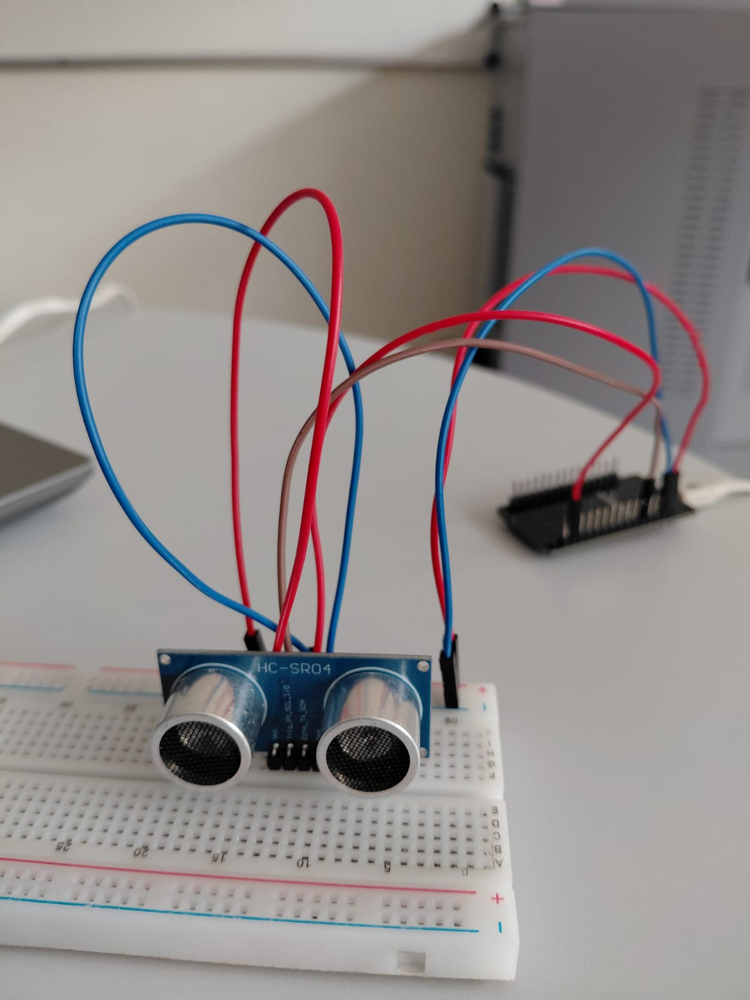
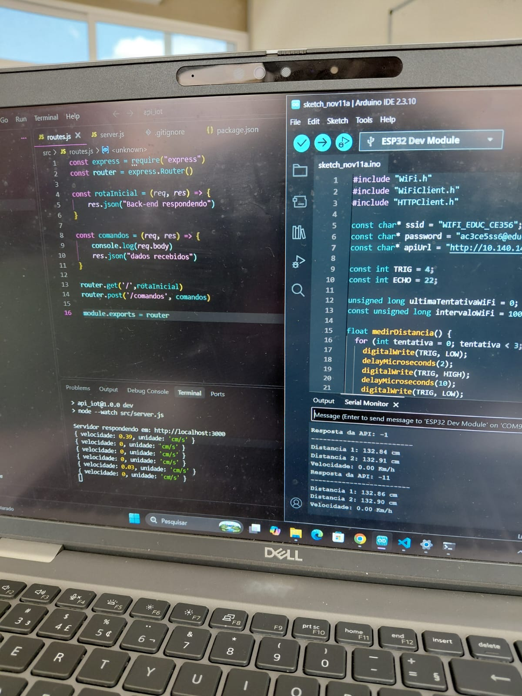
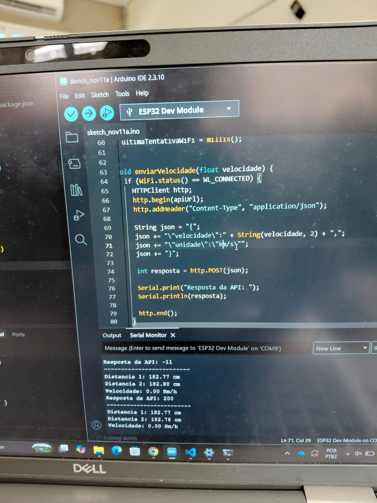

# Projeto: Sensor Ultrassônico com ESP32

## Sobre o projeto

Este projeto tem como objetivo utilizar um sensor ultrassônico para medir distâncias e calcular a velocidade de um objeto em movimento.

O sistema utiliza um ESP32 conectado à rede Wi-Fi para enviar os dados de velocidade a uma API desenvolvida em Node.js, permitindo o recebimento e o processamento das informações.

## Tecnologias utilizadas

- **ESP32:** responsável pelo processamento e comunicação Wi-Fi.
- **Sensor Ultrassônico HC-SR04:** utilizado para medir distâncias.
- **Arduino IDE:** ambiente de desenvolvimento e programação.
- **C++:** linguagem utilizada na programação do ESP32.
- **Node.js:** utilizado para desenvolver a API.
- **HTTP:** protocolo utilizado para enviar os dados.
- **JSON:** formato utilizado para transmitir as informações.

## Componentes utilizados

- 1 ESP32
- 1 Sensor Ultrassônico HC-SR04
- Jumpers para conexão
- Protoboard (opcional)

## Funcionamento

1. O ESP32 realiza a conexão com a rede Wi-Fi.
2. O sensor ultrassônico realiza a primeira medição de distância.
3. Após um intervalo de tempo, é realizada uma segunda medição.
4. O sistema calcula a velocidade do objeto com base na diferença entre as distâncias e o tempo decorrido.
5. Os dados são enviados para uma API por meio de uma requisição HTTP POST.
6. A API recebe os dados no formato JSON.

## Estrutura dos dados enviados

Os dados são enviados no seguinte formato:

```json
{
  "velocidade": 10.50,
  "unidade": "cm/s"
}
```

## Imagens do projeto

### Montagem dos componentes

 

### Projeto em funcionamento



### Monitor Serial



## Configuração

Para executar o projeto:

1. Instale a Arduino IDE.
2. Configure o ESP32 na Arduino IDE.
3. Conecte o sensor ultrassônico aos pinos definidos no código.
4. Configure o nome e a senha da rede Wi-Fi.
5. Informe o endereço IP da API no código.
6. Faça o upload do programa para o ESP32.
7. Abra o Monitor Serial para acompanhar as medições.

## Objetivo educacional

O projeto foi desenvolvido com o objetivo de aplicar conhecimentos de Internet das Coisas (IoT), programação de microcontroladores, comunicação Wi-Fi, sensores e integração entre dispositivos físicos e APIs.

## Integrantes do grupo

- Isabelle Borges
- Gabrielly Souza
- Mirella Brolezi
- Maria Eduarda Urbano

**Curso:** Desenvolvimento de Sistemas – SENAI.

